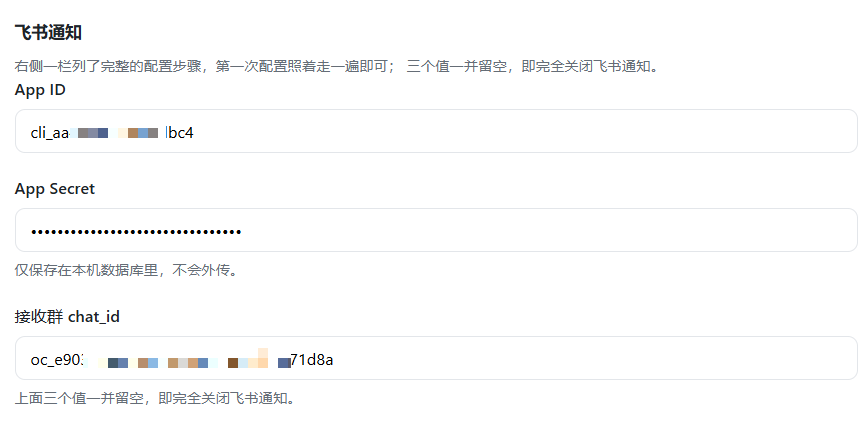

# 使用方法

> 返回 [README](../README.md) · 通知配置见 [飞书](feishu.md) / [Telegram](telegram.md) / [Webhook](webhook.md)


## 全流程

```
定时巡检
  ├─ 采集：列出本机容器 → 每个容器一条记录（容器维度）
  │        再列出本机镜像 → 凡是没有容器在用的，也各记一条（镜像维度）
  │        WATCH 环境变量配的远端项，本机没有镜像，归入镜像维度
  ├─ 比对：向注册表查询当前 tag 的 manifest digest
  │        版本号 tag 额外巡检仓库 tag 列表，发现更高版本
  └─ 通知：只对**容器维度**的差异推消息（飞书卡片 / Telegram 消息，含「立即更新 / 稍后 / 忽略」；
           Webhook 只有纯通知，更新需回面板操作）；
           镜像维度不检测、不提醒 —— 没人用的镜像不该打扰你

你点「立即更新」
  ├─ 回调：飞书长连接把 card.action.trigger 推给本服务；Telegram 靠长轮询收 callback_query
  ├─ 拉取：docker pull 新镜像
  ├─ 重建：compose 起的容器 → 交回 docker compose up -d（见下）
  │        其它容器        → inspect 原容器 → 停旧 → 改名备份 → 用原配置创建新容器 → 启动
  ├─ 校验：观察窗口内健康检查（容器是否存活 / HEALTHCHECK 是否 healthy）
  └─ 收尾：通过则删除旧容器，不通过则自动回滚并重新拉起旧容器
```

## compose 起的容器，就交给 compose 更新

「按原配置重建」是把 inspect 到的配置原样搬进一个新容器，可它搬不出 compose 的标签：
新容器身上没有 `com.docker.compose.*`，项目从此认不出它 —— `compose ps` 看不到，
下次你在 1Panel 或项目目录里 `compose up`，compose 以为服务没起过，又造一个同名容器，
撞名之后两头都管不了。家里几乎所有容器都是 compose 起起来的，
所以每次更新都在攒一个孤儿。

现在更新前先看标签，能认出归属的就改用 compose 重建：

- 只重建**这一个服务**：`docker compose -p <项目> --project-directory <项目目录> -f <原文件> up -d <服务>`；
- 新镜像版本写在临时 override 里，**项目自带的 compose 文件一个字都不改**（改的只有 image）；
- 重建本身在一次性辅助容器里完成（挂项目目录 + `docker.sock`），所以设置里的 `HOOK_IMAGE`
  必须是带 compose 插件的镜像，`tools/hook-runner` 那个就够；
- 辅助容器里没有 compose、或那份配置读不通 → 预检以约定退出码返回，**此时还没碰过任何容器**，
  自动回落到「按原配置重建」，任务日志会写明原因；
- 回滚照做，只是方式不同：compose 会自己删掉旧容器，留不住改名备份，
  所以动手前先把旧镜像按 ID 钉一个 `autodocker-rollback:<项目>-<服务>-<短ID>` 标签，
  健康检查不过时再用同一份 compose 配置退回那一版（成功后该标签自动清掉，回滚过则保留）；
- 原本停着的服务不会因为「更新」被顺手启动：`up` 起来之后再按原状态停回去。

`update.sh` 那类脚本型监控项优先级更高：配了启用中的更新脚本就走脚本，
不叠加 compose 路径 —— 项目自己说了怎么更新，就按它说的来。

## 「容器」与「镜像」是两个列表

页面上把它们分开，因为这是两种东西，操作代价完全不同：

|  | 容器 | 镜像 |
| --- | --- | --- |
| 是什么 | 正在跑的那个实例 | 磁盘上的只读层 |
| 一条记录对应 | 一个容器 | 一个 `仓库:tag`，没有 tag 的悬空层单独一条 |
| 会检测有没有新版吗 | **会**，发现新版推送到飞书 / Telegram / Webhook | **不检测**，页面上也不标状态 |
| 能做什么 | 「更新」= 拉新镜像 **+ 按原配置重建容器**，**只在检测到新版时才出现**；「忽略」让它不再提醒；「移除」只移除监控记录（容器本身不动） | 只有「删除」，真的删掉镜像层、回收磁盘 |

两个列表不会重复：容器页一个容器一条；镜像页列的是**本机全部镜像**
（含正在被容器使用的），在用的标「使用中」，没容器引用的标「未使用」——
后者才是「清理镜像」能动的对象。WATCH 配的纯远端项（本机没这份镜像）
也列在镜像页，标为「仅监控」，它没有可删除的实体。

compose 起的容器会按项目折叠成组：组头写项目名、服务数，有新版时再标「N 个有更新」，
点一下收起或展开；页头的「全部收起 / 全部展开」可以一次处理所有分组。
**只有两个及以上容器的项目才折叠**；单容器项目直接平铺一行，不套组头。
**组内仍然一个容器一行** —— 同一项目的服务镜像和状态各自独立，
「更新」也只重建对应的那个服务（`docker compose up -d <service>`，不动同项目其他服务）。
`docker compose run` 的一次性容器没有可重建的服务，不算进分组；没有 compose 标签的容器
单独列在「未分组的容器」下。搜索框里输入项目名会命中整组并自动展开。

容器页的按钮按情况出现，不给点不动的灰按钮：**「更新」只在检测到新版时才有**
（「有更新」「可选更新」两种情况）。「已是最新」本来就没有新镜像可拉，
摆一个灰按钮只会让人反复去点、点完没反应；「未知」「已忽略」同理 ——
前者是这一轮没查到，后者是你自己说了先不动。检测失败的原因写在容器名下方的小字里，
比一个「未知」徽章有用得多。

## 直接查看与编辑 compose 文件

容器名后面的 `compose` 胶囊打开的是这个项目自己的配置文件。路径来自容器标签里的
`working_dir` / `config_files`，和「更新」用的是同一份，不是页面自己猜的。

- **保存**先在同目录留一份 `<文件名>.bak-<时间戳>` 备份，再用临时文件原子替换；
  写到一半失败，项目里仍是原来那份文件。内容没变时不写盘、不留备份。
- **应用**执行 `docker compose up -d`（整个项目）：配置有变化的服务会被重建，
  原本停着的服务也会被启动。执行前先 `docker compose config --quiet` 预检，
  YAML 写坏了在这一步就失败，不会动到任何容器。
- 只认标签里列出的那几份文件，其他路径一律拒绝；文件不存在时不新建。

面板容器默认只看得到 docker.sock，要用这个功能得把宿主机目录挂进来：

```yaml
volumes:
  - /var/run/docker.sock:/var/run/docker.sock
  - ./data:/data
  - /opt/1panel:/host/1panel   # 宿主机路径 : 面板内挂载点
```

宿主机根目录与挂载点分别由 `COMPOSE_HOST_ROOT`（默认 `/opt/1panel`）和
`COMPOSE_MOUNT_ROOT`（默认 `/host/1panel`）指定。没挂载时弹窗会直接写明还缺哪一行，
不会给一个空白编辑器。

## 容器名就是它的访问地址

容器页上，名字后面跟着一个强调色的「打开」小胶囊（名字本身也可以点）：点开是新标签页里的
`http(s)://<你打开面板用的地址>:<端口>/`。
端口每次刷新都现从 Docker 读，所以改了 `-p` 之后不用再扫描、也不会留一条死链在库里。

不是每个容器都有这个链接，以下几种刻意不给：

- **停着的容器**：点开是「拒绝连接」，不如没有；
- **只绑了 `127.0.0.1` 的端口**（`-p 127.0.0.1:8080:80`）：从局域网点不开；
- **只有 `EXPOSE` 没有发布**（`docker ps` 里不带 `->` 的那些）：宿主机上根本没有这个端口；
- **UDP**：没有能点开的网页。

一个容器发布了好几个端口时，跳的是最像「主入口」的那个 —— 先看容器内是不是
443/8443/80/8080/3000 这类 Web 端口（443/8443/9443 自动用 `https`），
都不是才按宿主机端口从小到大排。剩下的端口写在悬浮提示里。
`--net=host` 的容器照常给链接，Docker 报的宿主机端口就是它监听的端口。

## 两个忽略粒度

别混：

- **飞书卡片上点「忽略本版本」** → 只放行**这一次远端内容**。服务会把这个版本的
  远端摘要记到监控项上，只要仓库没再推新内容（摘要不变）就不再提醒；一旦作者
  推了新一版（摘要变了）照常通知。容器页对这类容器显示「**已忽略本版本**」徽章，
  按钮变成「恢复提醒」，点一下清掉标记、恢复通知。
- **容器页点「忽略」** → 整条监控项都不再检测（状态变「已忽略」），按钮变「恢复」。
  这个开关在设置里也能看到。

两种「忽略」都会被静默跳过，不会因为漏掉一次巡检而反复推同一张卡片。

> 比的是**摘要**不是 tag —— 浮动 tag（latest）下 tag 永远不变，
> 按 tag 比等于「忽略」一次就永久静音。

## 「可用」列写的是什么

写的是**仓库里更高的版本号**，不是「点更新会拉到什么」：

- 仓库里有更高的版本号 → 显示那个 tag；
- 没有更高版本号、但同一个 tag 的内容被作者重新推送了 → 写「内容已更新」。
  这类镜像（tag 是「大版本 + 架构」并列发布的那些）永远不会有「更高版本」，
  点更新拉到的还是同一个 tag，只是拿到它的最新内容，版本号不变；
- 已是最新、或这一轮没查到 → 留横杠。

镜像页每行两行文字：**第一行是镜像名，第二行是镜像 ID**，跟 `docker images` 的输出一眼就能对上。

## 悬空镜像怎么显示

没有 tag 的悬空层（被新版本顶下来的旧镜像层）在 Docker 里确实没有名字，
`docker images` 也只显示 `<none>`。但镜像**构建时写进配置的标签**还留在镜像里，
其中往往带着原始名字或源码仓库地址，所以这里按下面的顺序找回一个可读的名字：

1. `org.opencontainers.image.title`
2. `org.label-schema.name`
3. `org.opencontainers.image.ref.name`
4. `org.opencontainers.image.source` / `org.label-schema.vcs-url`（取仓库地址最后一段，去掉 `.git`）
5. `RepoDigests` 里的仓库名

一条都挖不到才退回显示短 ID —— 第一行是 `d825b9c26134` 这种裸 ID（`docker images` 的
IMAGE ID 列就是这个形式，可以直接拿去命令行对），第二行注明「历史残留镜像层」。
一屏好几个 `<none>` 谁也分不清谁，短 ID 至少能唯一指认。这类镜像归入「未使用」。

## 清理镜像

「清理镜像」弹窗里可以选择清理范围：

- **无 TAG 镜像**：悬空层，通常是重新构建后残留的，最该清；
- **未使用镜像**：没有任何容器引用的，范围更大。

两种情况都会跳过仍被容器占用的镜像 —— 那些请到「容器」页更新。

镜像页只给一个动作，不给点不动的灰按钮，也不摆检测状态：

- 没有容器在用的镜像给「删除」，删掉即回收磁盘；
- 正在被容器使用的镜像**没有「删除」** —— 删了它，容器下次重启就起不来；
- **这一页没有「更新」，也不显示「可选更新 / 未检测 / 未知」这类状态**。
  镜像有没有新版是容器维度的事，那边点「更新」会真的重建容器；镜像页上再摆一套，
  只会让人分不清「点下去到底动了什么」。磁盘上这层归谁用、能不能清，才是这一页要回答的。

按钮只在该出现的时候渲染，没有可执行动作的行（比如使用中的镜像不能删）操作列显示一个
浅色横杠，保持列对齐。

## 两种检测模式

| 模式 | 适用 tag | 行为 |
| --- | --- | --- |
| 摘要比对 `digest-only` | `latest`、`stable`、`edge` 等浮动 tag | 比对远端 manifest digest，变了就提醒 |
| 版本监听 `pin-watch` | `1.25`、`v3.9`、`1.2.3-alpine` 等版本号 tag | 比对摘要之外，还巡检仓库 tag 列表，出现更高版本时提醒「可选更新」 |

默认按 tag 形态自动分配，也可以在「容器」列表里手动固定
（列表里「检测模式」那一列就是个下拉框，选「自动」即恢复自动判定）。

tag 里的数字并不总是版本号。有些镜像把 tag 写成「大版本 + 架构」并列发布，
比如 `v3` / `v3-amd64` / `v3-386` / `v3-armv7` —— 其中的 `386` 是 32 位 x86 架构，
不是「第 386 版」。比较之前会把这类结尾的架构段（`amd64`、`arm64`、`armv7`、`386`、
`x86_64` …）剥掉，否则同一批并列的 tag 之间会互相报「有更新」，
而它们其实只是同一个大版本的不同架构。

## 脚本检测：本机自建的镜像

上面两种模式都建立在「远端有个仓库可以比」之上。本机 `docker compose build` 出来的
镜像（`kuku2api:local` 这类）不在任何仓库上，比无可比 —— 但它的项目目录里往往已经有
一个 `update.sh`，把「查上游 → 重建 → 起容器 → 失败回滚」都做完了。

「容器」列表里点这一行的**脚本**按钮，把配置以整份 JSON 存进去，这一项就改由脚本说话：

```json
{
  "enabled": true,
  "cwd": "/opt/1panel/docker/compose/kuku2api",
  "check_cmd": "./update.sh --check",
  "update_cmd": "./update.sh",
  "network": "host"
}
```

退出码沿用这类包装脚本本来的约定：

| | 退出码 |
| --- | --- |
| `check_cmd` | `10` = 有可用更新，`0` = 已是最新，其余 = 检查失败（输出尾部会写在列表小字里） |
| `update_cmd` | `0` = 成功，`1` = 更新失败但脚本已自行回滚（记为「已回滚」而不是「失败」），其余 = 失败 |

几点必须知道：

- 脚本跑在一个**一次性辅助容器**里。`cwd` 与 `mounts` 列出的宿主机目录按同样的路径挂进去，
  `/var/run/docker.sock` 总是自动挂上，所以脚本里的 `docker`、`compose` 操作的是宿主机本身。
  路径一律写**宿主机的绝对路径**。
- 这一项的检测模式与仓库比对都不再参与，列表里那一格会写明「脚本检测」。
- 「忽略本版本」照样有效：这里比的是本机镜像 ID（形如 `hook@1a2b3c`），
  镜像一旦重建 ID 就变，抑制自动解除。
- 更新过程没有本服务的自动回滚：脚本自己带回滚，这里不重复猜测现场，
  否则会把脚本已经处理好的东西搅乱。
- 辅助容器的镜像每条配置里写 `image`，或给服务设 `HOOK_IMAGE` 兜底。
  别直接拿 `docker:24-cli` 用 —— 那些包装脚本还要 bash、curl、git、python3，
  现成的 cli 镜像里没有。用 `tools/hook-runner/Dockerfile` 自己拼一个：

  ```sh
  docker build --network host -t autodocker-hook-runner:local tools/hook-runner
  ```

弹窗里的**测试检查**会立刻起一个辅助容器跑 `check_cmd`，把退出码和输出原样显示出来。
它会先保存当前这份 JSON 再执行 —— 后端只认库里那份配置。

## 顶部数字与页面自动刷新

顶部那排数字统计的是**容器**：有多少个容器在监控、几个有更新、几个已是最新。
镜像页讲「磁盘上有什么、能不能清」，容器页讲「在跑的东西该不该更新」，顶栏跟着后者走。

页面会自己刷新，不用手动按 F5：

- 每 5 秒回查一次状态，任务运行中与刚结束时都会重载结果；空闲时每 30 秒整份重载。
- 从别的窗口切回来、或重新拿到焦点，会立刻刷新一次。
- 升级后打开页面不会还跑着上一版的脚本。

## 界面与主题

页面是深色玻璃拟态风格：深蓝底 + 光斑，半透明卡片带背景模糊，顶栏吸顶。

**深浅两套皮肤，顶栏右上角（以及登录页右上角）可切换**，默认深色，选择记在浏览器本地，
下次打开沿用。

## 登录

默认不启用。在「设置」里配上密码后，打开页面需要先登录，凭据记在浏览器里，下次不用重输。

## 设置页



左栏参数、右栏指引：巡检间隔、镜像加速地址、通知渠道与凭据、访问密码都在这里改，**保存即生效，不用重启**。

「通知渠道」是一排胶囊按钮：点哪个，左栏就换成它的输入框、右栏换成它的配置流程。
Webhook 是最省事的一个：贴入群机器人的地址即可，只推送、不带按钮
（详见 [webhook.md](webhook.md)）。
灰色的是还没做的渠道（钉钉、企业微信、Slack、Discord、Gotify、ntfy、Bark、邮件），暂时不能选。

「检测注册表连通性」会逐个源打一次探针，把每个源的耗时或失败原因列出来 ——
列表整列「未知」时先点这个，比猜要快。

## 忽略的两个开关在哪里

- 容器页每行的「忽略 / 恢复」；
- 设置页也能看到当前被整条忽略的监控项。
